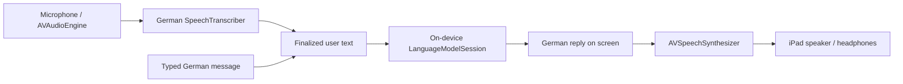

# Sound Flux — German voice agent for iPad

Design reference · 23 September 2026. See [README.md](README.md) for the implemented
first version and its deliberate scope reductions. This document includes later
features and acceptance targets, not a claim that every feature is implemented.

A user speaks German to Sound Flux and receives a short, spoken German reply.
Microphone capture, transcription, conversation, and voice output run on the
**iPad Air M4 itself**, including when it is disconnected from the internet.
Initial installation and language/model downloads may require a connection.

The first milestone is conversation. Music playback and generation are separate
extensions, pending product direction. The existing desktop application remains
the reference for Sound Flux's tone, accessibility, and visual identity.

## Platform decision

Build a native **SwiftUI iPad app**, targeting **iPadOS 26 or later**, using Apple
frameworks for the first implementation. Use the explicitly on-device
`SystemLanguageModel.default` for conversation; do not select Private Cloud
Compute or another remote model. Apple's framework now also exposes remote
capabilities, so “uses Foundation Models” alone is not an offline guarantee.
[On-device model documentation](https://developer.apple.com/documentation/foundationmodels/systemlanguagemodel),
[Foundation Models overview](https://developer.apple.com/documentation/foundationmodels).

Apple lists the iPad Air M4 with 12 GB unified memory and a 16-core Neural Engine.
This makes it a suitable target for Apple's device-supported models; it does not
establish the app's available memory budget or prove conversational latency.
Both require testing on the physical iPad.
[iPad Air specifications](https://www.apple.com/ipad-air/specs/).

| Responsibility | Initial choice | Local execution contract |
| --- | --- | --- |
| Interface | SwiftUI | German controls, large touch targets, VoiceOver and Dynamic Type |
| Microphone | `AVAudioSession` + `AVAudioEngine` | Capture only during an explicitly active listening turn |
| Speech to text | `SpeechAnalyzer` + `SpeechTranscriber` | Resolve German locale and install its assets through `AssetInventory` |
| Conversation | `LanguageModelSession` with `SystemLanguageModel.default` | Available on-device model, short replies, bounded history |
| Text to speech | `AVSpeechSynthesizer` | Select an installed German `AVSpeechSynthesisVoice` |
| Settings | `UserDefaults` | Voice identifier, speech speed, conversation preferences |
| Conversation memory | In-memory messages | Clear on session end; no transcript or audio persistence in v1 |

SpeechTranscriber performs recognition on device after its model assets are
installed. Apple also documents speech synthesis as on-device processing.
[SpeechAnalyzer introduction](https://developer.apple.com/videos/play/wwdc2025/277/),
[speech synthesis](https://developer.apple.com/documentation/avfoundation/speech-synthesis).

## German and offline readiness

The initial language is standard German (`de-DE`). Test Austrian German speakers
as well; German language support is not a promise of dialect accuracy. Prefer a
supported `de-AT` configuration when requested and available, otherwise explain
the standard-German fallback. Never silently switch to English.

Before showing **„Bereit zum Sprechen“**, perform these checks:

1. **OS and model:** query `SystemLanguageModel.default.availability`. Distinguish
   unsupported hardware, Apple Intelligence being disabled, and the model still
   preparing. Hardware eligibility alone is insufficient.
2. **Language:** check Foundation Models' supported languages/locales on the
   installed OS. Use `supportsLocale` where the deployed SDK/OS supports it;
   otherwise inspect `supportedLanguages`. German is supported by Apple
   Intelligence, but availability also depends on OS, settings, and region.
3. **Recognition:** check `SpeechTranscriber.isAvailable` and its supported
   locales. Reserve the selected locale, inspect `AssetInventory` status, and
   request missing assets with visible progress. Handle download and reservation
   failures; an unavailable German recognizer blocks voice input.
4. **Voice:** enumerate `AVSpeechSynthesisVoice.speechVoices()` and select an
   available German voice. Offer a short preview. Do not assume a named Siri
   voice or an enhanced voice is installed. Text output remains usable if voice
   output fails.
5. **Permission:** request microphone access when the user starts voice input;
   include a German `NSMicrophoneUsageDescription`. Denial leaves typing available
   if the language model is ready. Follow the selected Speech API's permission
   requirements rather than copying the older server-recognition flow.

Model preparation may require Apple Intelligence to be enabled in Settings,
compatible device/Siri language settings, free storage, and downloaded assets.
Recheck readiness after returning from Settings and before a session. Asset sizes
and OS behavior change; avoid promising a fixed download size or permanent asset
availability. No automatic cloud fallback is permitted.
[Apple Intelligence requirements](https://support.apple.com/en-us/121115),
[Foundation Models language support](https://developer.apple.com/documentation/foundationmodels/supporting-languages-and-locales-with-foundation-models),
[SpeechTranscriber capabilities](https://developer.apple.com/documentation/speech/speechtranscriber),
[AssetInventory](https://developer.apple.com/documentation/speech/assetinventory).

**Offline acceptance means:** after provisioning, a cold launch followed by a
complete spoken conversation succeeds with Wi-Fi and cellular disabled. This
must work without the Mac, a local server, or another device. A missing model
produces setup guidance, not a network inference request.

## Conversation experience

The user taps **„Mit Sound Flux sprechen“**, speaks, and taps **„Fertig“**.
Sound Flux transcribes the utterance, answers in German, and reads the reply.
The transcript and reply remain visible. The user can start another turn or end
the conversation at any time. Tapping is a toggle; holding a button is unnecessary.

Use the [German system prompt](SYSTEM_PROMPT.de.md). Default to a warm, respectful
“du”, with a “Sie” preference. Ask at most one question at a time. Name and music
preferences are optional; conversation must work without onboarding questions.

Example:

> **Person:** „Hallo, ich heiße Anna.“  
> **Sound Flux:** „Hallo Anna. Worüber möchtest du sprechen?“  
> **Person:** „Ich höre gern alte Schlager.“  
> **Sound Flux:** „Welchen Schlager magst du besonders?“

Start with explicit turn completion. After the offline speech loop is proven,
add optional **„Nach Sprechpausen antworten“**: start with 1.5 seconds of silence
after detected speech and expose a 1–3 second adjustment. Retain **„Fertig“** for
users whose pauses are longer. Silence must never create an empty model request.
Automatic re-listening is opt-in and only active while the app is in the foreground.

### Main screen

Reuse the current app's warm paper, brown, yellow, and orange palette. Use native
system fonts with Dynamic Type. Keep one dominant action and an always reachable
stop control; avoid a scrolling chat feed as the primary interaction.

```text
┌─────────────────────────────────────────────────────┐
│ Sound Flux                         Einstellungen    │
│                                                     │
│                 [Schallplattenmotiv]                │
│                                                     │
│                  Ich bin für dich da.               │
│            Tippe unten und sprich mit mir.           │
│                                                     │
│             [ Mit Sound Flux sprechen ]             │
│                                                     │
│ Du:        Hallo, ich heiße Anna.                    │
│ Sound Flux: Hallo Anna. Worüber möchtest du sprechen?│
│                                                     │
│ [Nachricht schreiben]          [Gespräch beenden]    │
│ Auf diesem iPad · Deutsch                           │
└─────────────────────────────────────────────────────┘
```

Use at least 56-point primary/stop targets, readable text, sufficient contrast,
portrait and landscape layouts, and non-color state labels. Respect Reduce Motion.
Announce state changes accessibly without repeatedly announcing each transcript
fragment. With VoiceOver active, avoid competing simultaneous readings of a reply.

| State | Visible message | Main action |
| --- | --- | --- |
| Setup needed | „Deutsch wird vorbereitet.“ | Progress / retry / settings guidance |
| Ready | „Ich bin für dich da.“ | „Mit Sound Flux sprechen“ |
| Listening | „Ich höre zu.“ + live transcript | „Fertig“ |
| Transcribing | „Ich verarbeite deine Worte.“ | „Abbrechen“ |
| Thinking | „Einen Moment bitte.“ | „Abbrechen“ |
| Speaking | Reply text + „Sound Flux spricht.“ | „Antwort stoppen“ |
| Recoverable failure | Brief explanation and retained text | „Erneut versuchen“ |

Typing uses the same conversation path. Keep **„Gespräch beenden“** available
throughout an active session. Ending clears the session; stopping a single answer
keeps completed earlier turns.

While listening, recognize explicit standalone commands such as **„Stopp“**,
**„Gespräch beenden“**, and **„Ich möchte jetzt aufhören“** before requesting a
model response. Normalize case, whitespace, and final punctuation, then match
whole utterances rather than substrings (a discussion about the word “Stopp” must
not end the session). These commands end the session in app code. Other phrasings
can receive a brief reply pointing to the end button; the prompt alone cannot
stop capture or erase session memory.

## Audio and turn ownership



One conversation controller owns the audio engine, transcription work, model
task, speech synthesizer, and current turn identifier. Use one active turn and
one audio-session owner. Separate capture/transcription into a helper only when
the implementation needs it; a backend service and agent framework are unnecessary.

- Capture with a record/playback audio session. Determine the analyzer's supported
  audio format and convert from the hardware format; never hard-code microphone
  sample rate. Bound the audio queue and process off the main thread.
- Show provisional transcript segments, replacing them when finalized; never
  append both versions. **„Fertig“** closes capture and finalizes remaining audio
  before sending exactly one non-empty user turn to the model.
- Initial limits: 60 seconds per recording and 1,000 characters per user message.
  At the recording limit, finalize the turn and tell the user. An overlong message
  remains editable and is not silently truncated.
- Pause microphone capture during reasoning and spoken output. This prevents the
  assistant from transcribing itself. **Spoken interruption while the assistant
  is talking is outside v1**; the visible stop button works immediately.
- Stopping cancels active work, stops synthesis, removes audio taps, and invalidates
  the turn identifier. Every asynchronous callback checks that identifier before
  updating the screen or starting playback. Ending additionally discards memory.
- Handle audio interruptions, headphone removal, route changes, and app backgrounding
  by stopping capture/output and returning to a paused/ready state. Resuming requires
  an explicit user action; do not promise background wake-word listening.
- Keep a completed text answer if synthesis fails. Never restart a canceled answer
  when a delayed transcription or model response arrives.

For the first version, generate a complete short answer before speech synthesis.
Sentence streaming can be added if measured latency requires it; it introduces
extra queueing and cancellation behavior.

## Model behavior and memory

The model handles short conversation, not unrestricted research or factual
authority. It has no web lookup or music actions in v1. Unsupported requests get
an honest German explanation. Model output is text, never executable instructions.

Load the German prompt as instructions and pass the user's message separately.
Keep guardrails enabled. Bound output to a small token budget (initially 120) and
request one or two short sentences. Handle refusals, generation failures, and
unsupported-language errors with understandable German copy.

Keep only recent completed exchanges in memory. Build each turn from the fixed
instructions and a bounded recent history so canceled/partial turns cannot leak
into the next request. Initially retain at most three completed exchanges, dropping
oldest exchanges until the available context budget is satisfied; reserve room
for output. A turn-count cap alone is not a token guarantee.

Apple documents a 4,096-token context for the original on-device model. On OS/SDK
versions with context-size/token-count APIs, use them. On the iPadOS 26 baseline,
use conservative input bounds and handle context overflow by retrying once with
reduced history. If it still fails, explain the error rather than looping.
[Context management](https://developer.apple.com/documentation/foundationmodels/managing-the-context-window).

Store no microphone recordings, transcripts, or prompts in logs. Persist only
non-conversational settings. A later “remember me” feature needs explicit user
choice, local storage with an intentional backup policy, and deletion controls;
it is not necessary for the first offline conversation.

## Relationship to this repository

| Existing piece | Reuse in the iPad design |
| --- | --- |
| [`frontend/src/hooks/useCompanion.ts`](../frontend/src/hooks/useCompanion.ts) | Turn ownership, cancellation semantics, visible recording states |
| [`frontend/src/index.css`](../frontend/src/index.css) | Color palette and accessible visual hierarchy |
| [`local-speech/api/app.py`](../local-speech/api/app.py) | Warm companion tone and optional personal questions |
| Existing Python / Ollama / MLX speech services | Desktop reference only; no iPad runtime dependency |
| Existing profile/history APIs | No connection in v1; conversations stay in the native app's memory |
| [`audio-engine/`](../audio-engine/) | Separate music-generation project; no claim that it fits this iPad design |

The desktop implementation currently requests English recognition and synthesis
and includes a MusicBrainz network lookup. Copying that pipeline would violate
the German/offline target. Reuse interaction decisions, not its server topology.

If music controls are added, expose only explicit local actions such as play,
pause, and volume against bundled/imported audio. Validate model-selected actions
in app code and confirm completion only after the player succeeds. A spoken
“Stopp” during listening should be handled deterministically. Generated music and
commercial streaming require their own feasibility decisions.

## Implementation order and acceptance

1. **Prove one offline turn on the physical iPad.** Check readiness, capture German,
   generate one local reply, and synthesize it. This is the technical go/no-go gate.
2. **Add conversation ownership.** Cancellation, short memory, typing, German errors,
   permission denial, route changes, and foreground-only lifecycle handling.
3. **Apply the accessible interface.** Large controls, Dynamic Type, VoiceOver,
   speech-speed preference, then optional pause detection.

Use one native app target and Apple frameworks initially. Create the Xcode project
inside this folder when implementation starts. Development/signing can use a Mac;
the installed app must pass all runtime checks with that Mac switched off.

| Physical-device check | Pass condition |
| --- | --- |
| Provision, disconnect, cold-launch | Ten German voice turns complete with Wi-Fi/cellular off and no Mac/server |
| German input | Meaning preserved for ordinary German, umlauts, names, numbers, and Austrian-accent samples |
| German output | German voice and concise German replies; no unexpected English fallback |
| Missing assets / disabled Intelligence | Specific setup guidance; no cloud inference or false ready state |
| Microphone denied / silent recording | Typing still works when model ready; silence produces no model turn |
| Stop during capture, reasoning, and output | Capture/output stop; delayed callbacks cannot resurrect the turn |
| Spoken end command while listening | Session ends without asking the model; a quoted mention of “Stopp” does not trigger it |
| Speaker playback | Assistant speech never becomes a new user turn |
| Background, headphone removal, audio interruption | Audio stops predictably and remains stopped until explicit resume |
| Fifty successive turns | No context-overflow loop or unbounded audio/history growth |
| Voice synthesis failure | Text reply remains readable and a retry is available |
| End and relaunch | Previous conversation is absent; chosen non-conversational settings remain |
| Accessibility | VoiceOver, large text, reduced motion, and both orientations remain usable |

Record warm and cold timings separately. Initial **targets, not measured claims**:
warm p95 end-of-utterance-to-first-spoken-reply at most 3 seconds (excluding an
optional silence threshold), touch-to-stop under 250 ms, and a 20-minute session
without a crash or thermal shutdown. Measure app memory, system memory pressure,
thermal state, and battery drain on the target iPad; no benchmark has been run yet.

If Apple's German recognition or conversational quality fails this gate, evaluate
a bundled multilingual speech/model runtime in a separate measured spike. Do not
add a second inference stack until the native version demonstrates a concrete gap.
